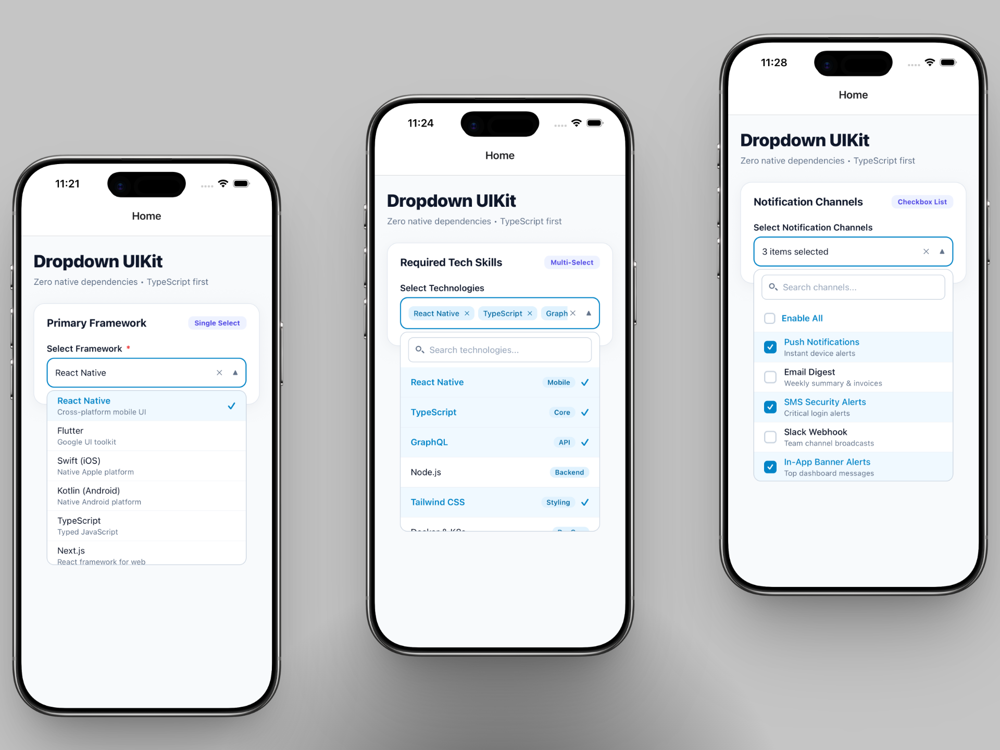
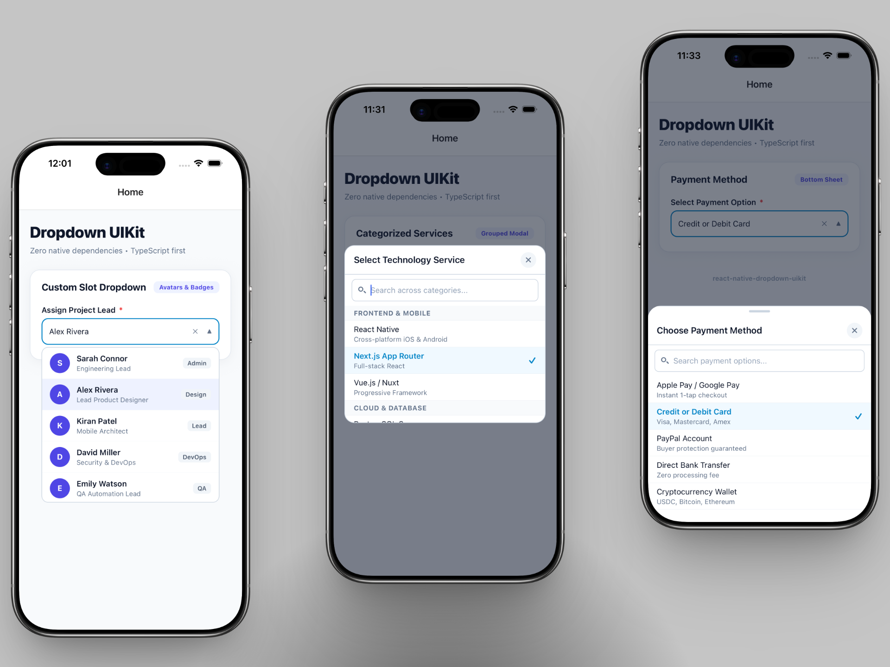

# react-native-dropdown-uikit

<p align="center">
  
</p>

<p align="center">
  
</p>

A scalable, production-ready, zero-external-dependency React Native dropdown UI kit built with TypeScript. Runs seamlessly across React Native CLI and Expo (Managed & Bare) on iOS and Android.

---

## Highlights

- **Zero External Dependencies**: Pure React Native primitives (`Modal`, `Animated`, `FlatList`, `TextInput`, `Pressable`, etc.). No native linking or build configurations needed.
- **10 Dropdown Variants + Universal Router**:
  1. `BasicDropdown` - Clean single selection popover
  2. `SearchableDropdown` - Real-time client-side search filtering
  3. `MultiSelectDropdown` - Multiple choice selection with removable interactive chips
  4. `CheckboxDropdown` - Animated checkboxes with "Select All" toggle
  5. `CountryDropdown` - ~250 ISO countries bundled with flags & dial codes
  6. `CascadingDropdown` - Multi-level hierarchical drilldown with breadcrumbs
  7. `BottomSheetDropdown` - Native-feel animated slide-up mobile drawer
  8. `GroupedDropdown` - Sectioned categories with sticky headers and search
  9. `CustomDropdown` - Render slots for custom triggers, rows, badges, and avatars
  10. `AutocompleteDropdown` - Editable input trigger with real-time suggestion popup
  - `Dropdown` - Universal router rendering any of the 10 modes dynamically via `mode="..."`
- **Separation of Presentation & Placement**:
  - `presentation`: `'popover' | 'modal' | 'bottom-sheet'`
  - `placement`: `'auto' | 'top' | 'bottom'`
- **Headless Hooks**: `useDropdown`, `useMultiSelect`, `useTheme`, `useKeyboard`, `useRTL`
- **Full Form Integration**: `label`, `required`, `error`, `helperText`, `disabled`
- **Dynamic Theming**: Light/Dark mode with automatic OS detection and deep theme merging.
- **Internationalization & RTL**: Inbuilt bidirectional layout support (Arabic, Hebrew, Urdu).

---

## Installation

```bash
npm install @izonnet-web-solution/react-native-dropdown-uikit
# or
yarn add @izonnet-web-solution/react-native-dropdown-uikit
# or
pnpm add @izonnet-web-solution/react-native-dropdown-uikit
```

> **Note**: Also compatible with unscoped install: `npm install react-native-dropdown-uikit`.

---

## Quick Start

```tsx
import React, { useState } from 'react';
import { View } from 'react-native';
import { BasicDropdown } from '@izonnet-web-solution/react-native-dropdown-uikit';

const FRAMEWORKS = [
  { label: 'React Native', value: 'react-native' },
  { label: 'Flutter', value: 'flutter' },
  { label: 'Swift', value: 'swift' },
  { label: 'Kotlin', value: 'kotlin' },
];

export default function App() {
  const [selected, setSelected] = useState<string | null>(null);

  return (
    <View style={{ padding: 20 }}>
      <BasicDropdown
        label="Framework"
        placeholder="Select framework..."
        items={FRAMEWORKS}
        value={selected}
        onChange={setSelected}
        clearable
      />
    </View>
  );
}
```

---

## Universal Component (`Dropdown`)

The `Dropdown` component acts as a dynamic router. Pass `mode="..."` to render any variant on the fly:

```tsx
import React, { useState } from 'react';
import { Dropdown } from '@izonnet-web-solution/react-native-dropdown-uikit';

export function DynamicDropdownExample() {
  const [val, setVal] = useState<string | null>(null);

  return (
    <Dropdown
      mode="searchable"
      label="Choose Skill"
      items={[
        { label: 'JavaScript', value: 'js' },
        { label: 'TypeScript', value: 'ts' },
        { label: 'Python', value: 'py' },
      ]}
      value={val}
      onChange={setVal}
      searchPlaceholder="Filter skills..."
    />
  );
}
```

---

## 10 Dropdown Variants & Examples

### 1. `BasicDropdown`
A lightweight single-selection dropdown with floating/popover positioning.

```tsx
import { BasicDropdown } from '@izonnet-web-solution/react-native-dropdown-uikit';

<BasicDropdown
  label="Account Type"
  placeholder="Choose account type"
  items={[
    { label: 'Personal', value: 'personal' },
    { label: 'Business', value: 'business' },
  ]}
  value={accountType}
  onChange={setAccountType}
/>
```

---

### 2. `SearchableDropdown`
Includes an integrated search bar with instant filtering.

```tsx
import { SearchableDropdown } from '@izonnet-web-solution/react-native-dropdown-uikit';

<SearchableDropdown
  label="Select City"
  placeholder="Choose a city"
  searchPlaceholder="Search city name..."
  items={[
    { label: 'New York', value: 'ny' },
    { label: 'London', value: 'ldn' },
    { label: 'Tokyo', value: 'tky' },
    { label: 'Mumbai', value: 'mum' },
  ]}
  value={city}
  onChange={setCity}
/>
```

---

### 3. `MultiSelectDropdown`
Select multiple options rendered as removable tags/chips.

```tsx
import { MultiSelectDropdown } from '@izonnet-web-solution/react-native-dropdown-uikit';

<MultiSelectDropdown
  label="Skills & Technologies"
  placeholder="Select skills..."
  items={[
    { label: 'React Native', value: 'rn' },
    { label: 'TypeScript', value: 'ts' },
    { label: 'GraphQL', value: 'gql' },
    { label: 'Node.js', value: 'node' },
  ]}
  values={skills}
  onChange={(newValues, selectedItems) => setSkills(newValues)}
  maxSelect={5}
  searchable
/>
```

---

### 4. `CheckboxDropdown`
Multi-selection list with animated checkboxes and an optional **"Select All"** toggle.

```tsx
import { CheckboxDropdown } from '@izonnet-web-solution/react-native-dropdown-uikit';

<CheckboxDropdown
  label="Permissions"
  showSelectAll
  selectAllLabel="Select All Permissions"
  deselectAllLabel="Deselect All"
  items={[
    { label: 'Read Access', value: 'read' },
    { label: 'Write Access', value: 'write' },
    { label: 'Delete Access', value: 'delete' },
    { label: 'Admin Access', value: 'admin' },
  ]}
  values={permissions}
  onChange={(selectedValues) => setPermissions(selectedValues)}
/>
```

---

### 5. `CountryDropdown`
Pre-packaged with ~250 ISO countries, country codes, flag emojis, and international dial codes.

```tsx
import { CountryDropdown, CountryData } from '@izonnet-web-solution/react-native-dropdown-uikit';

<CountryDropdown
  label="Country / Region"
  placeholder="Select your country..."
  value={countryCode} // e.g. 'US' or 'IN'
  onChange={(country: CountryData | null) => {
    console.log(country?.name, country?.dialCode, country?.flag);
    setCountryCode(country?.code || null);
  }}
  showFlag={true}
  showDialCode={true}
/>
```

---

### 6. `CascadingDropdown`
Hierarchical multi-level dropdown for dependent categories (e.g., Country ➔ State ➔ City).

```tsx
import { CascadingDropdown, CascadingItem } from '@izonnet-web-solution/react-native-dropdown-uikit';

const LOCATION_TREE: CascadingItem[] = [
  {
    label: 'United States',
    value: 'us',
    children: [
      {
        label: 'California',
        value: 'ca',
        children: [
          { label: 'Los Angeles', value: 'la' },
          { label: 'San Francisco', value: 'sf' },
        ],
      },
    ],
  },
  {
    label: 'India',
    value: 'in',
    children: [
      {
        label: 'Maharashtra',
        value: 'mh',
        children: [
          { label: 'Mumbai', value: 'mum' },
          { label: 'Pune', value: 'pune' },
        ],
      },
    ],
  },
];

<CascadingDropdown
  label="Geographic Location"
  data={LOCATION_TREE}
  onChange={(selectedPath: CascadingItem[]) => {
    console.log('Selected Path:', selectedPath.map(item => item.label).join(' > '));
  }}
  separator=" > "
/>
```

---

### 7. `BottomSheetDropdown`
Opens options inside an animated mobile bottom sheet with drag handle and backdrop overlay.

```tsx
import { BottomSheetDropdown } from '@izonnet-web-solution/react-native-dropdown-uikit';

<BottomSheetDropdown
  label="Filter By Category"
  placeholder="Select category"
  items={[
    { label: 'Electronics', value: 'electronics' },
    { label: 'Clothing', value: 'clothing' },
    { label: 'Home & Kitchen', value: 'home' },
  ]}
  value={category}
  onChange={setCategory}
  searchable
/>
```

---

### 8. `GroupedDropdown`
Organize options into categorized sections with sticky section headers.

```tsx
import { GroupedDropdown, GroupedItem } from '@izonnet-web-solution/react-native-dropdown-uikit';

const GROUPED_FOOD: GroupedItem[] = [
  {
    title: 'Fruits',
    data: [
      { label: 'Apple', value: 'apple' },
      { label: 'Banana', value: 'banana' },
    ],
  },
  {
    title: 'Vegetables',
    data: [
      { label: 'Carrot', value: 'carrot' },
      { label: 'Broccoli', value: 'broccoli' },
    ],
  },
];

<GroupedDropdown
  label="Food Inventory"
  groups={GROUPED_FOOD}
  value={selectedFood}
  onChange={setSelectedFood}
  stickySectionHeaders
  searchable
/>
```

---

### 9. `CustomDropdown`
Complete render slot flexibility to build custom triggers, avatars, subtitles, and badges.

```tsx
import { CustomDropdown } from '@izonnet-web-solution/react-native-dropdown-uikit';
import { View, Text, Image } from 'react-native';

<CustomDropdown
  label="Assigned Team Member"
  items={[
    {
      label: 'Sarah Connor',
      value: 'sarah',
      subtitle: 'Engineering Lead',
      badge: 'Active',
      customData: { avatar: 'https://i.pravatar.cc/100?img=1' },
    },
    {
      label: 'John Doe',
      value: 'john',
      subtitle: 'Product Designer',
      badge: 'Away',
      customData: { avatar: 'https://i.pravatar.cc/100?img=2' },
    },
  ]}
  value={assignedUser}
  onChange={setAssignedUser}
  renderItem={(item, isSelected) => (
    <View style={{ flexDirection: 'row', alignItems: 'center', padding: 12 }}>
      <Image
        source={{ uri: item.customData?.avatar }}
        style={{ width: 36, height: 36, borderRadius: 18, marginRight: 12 }}
      />
      <View style={{ flex: 1 }}>
        <Text style={{ fontWeight: isSelected ? '700' : '500' }}>{item.label}</Text>
        <Text style={{ color: '#6B7280', fontSize: 12 }}>{item.subtitle}</Text>
      </View>
    </View>
  )}
/>
```

---

### 10. `AutocompleteDropdown`
An editable input box with dynamic suggestion popup and automatic keyboard avoidance.

```tsx
import { AutocompleteDropdown } from '@izonnet-web-solution/react-native-dropdown-uikit';

<AutocompleteDropdown
  label="Search Airport"
  placeholder="Type airport or city code..."
  items={[
    { label: 'JFK - John F. Kennedy Intl', value: 'JFK' },
    { label: 'LHR - London Heathrow', value: 'LHR' },
    { label: 'DXB - Dubai International', value: 'DXB' },
    { label: 'HND - Tokyo Haneda', value: 'HND' },
  ]}
  value={query}
  onTextChange={setQuery}
  onSelect={(item) => {
    setQuery(item.label);
    console.log('Selected airport:', item.value);
  }}
/>
```

---

## Props Reference

### Common Props
All dropdown variants inherit these core configuration props:

| Prop | Type | Default | Description |
|---|---|---|---|
| `items` | `DropdownItem<T>[]` | **Required** | Array of selectable options (`label`, `value`, `disabled`, etc.) |
| `value` | `T \| null` | `null` | Currently selected value |
| `onChange` | `(value: T) => void` | **Required** | Callback invoked when an item is selected |
| `placeholder` | `string` | `'Select option...'` | Placeholder text displayed when no item is selected |
| `presentation` | `'popover' \| 'modal' \| 'bottom-sheet'` | `'popover'` | Presentation container layout mode |
| `placement` | `'auto' \| 'top' \| 'bottom'` | `'auto'` | Preferred popover opening direction |
| `clearable` | `boolean` | `true` | Show a clear ("×") button when an item is selected |
| `disabled` | `boolean` | `false` | Disable interaction |
| `maxHeight` | `number` | `260` | Maximum height of the scrollable dropdown list |
| `itemHeight` | `number` | `48` | Fixed height per item for FlatList optimization |
| `searchPlaceholder` | `string` | `'Search...'` | Placeholder text for search inputs |
| `emptyText` | `string` | `'No options found'` | Empty state message when no items match |
| `emptyComponent` | `ReactNode` | `undefined` | Custom React node to render when list is empty |
| `loading` | `boolean` | `false` | Shows an ActivityIndicator spinner inside the list & trigger when options are loading |
| `loadingText` | `string` | `'Loading options...'` | Custom message displayed beneath the loading spinner inside the dropdown |
| `loadingComponent` | `ReactNode` | `undefined` | Custom React node to render instead of the default spinner |
| `onOpen` | `() => void` | `undefined` | Callback fired when dropdown opens |
| `onClose` | `() => void` | `undefined` | Callback fired when dropdown closes |

---

### Form Validation Props

| Prop | Type | Default | Description |
|---|---|---|---|
| `label` | `string` | `undefined` | Title label displayed above the dropdown trigger |
| `required` | `boolean` | `false` | Displays a red asterisk (`*`) next to the label |
| `error` | `string` | `undefined` | Error message displayed below the trigger with error styling |
| `helperText` | `string` | `undefined` | Helpful description or hint displayed below the trigger |
| `labelStyle` | `StyleProp<TextStyle>` | `undefined` | Custom style for the label text |
| `errorStyle` | `StyleProp<TextStyle>` | `undefined` | Custom style for the error text |
| `helperTextStyle`| `StyleProp<TextStyle>` | `undefined` | Custom style for the helper text |

---

### Styling Props

| Prop | Type | Description |
|---|---|---|
| `style` | `StyleProp<ViewStyle>` | Outer wrapper style |
| `triggerStyle` | `StyleProp<ViewStyle>` | Style applied to the clickable trigger button box |
| `dropdownStyle`| `StyleProp<ViewStyle>` | Style applied to the popup list card container |
| `itemStyle` | `StyleProp<ViewStyle>` | Style applied to each row item in the list |
| `itemTextStyle`| `StyleProp<TextStyle>`| Style applied to the text within each option row |

---

### Custom Slot Props

| Prop | Type | Description |
|---|---|---|
| `renderItem` | `(item: DropdownItem<T>, isSelected: boolean) => ReactNode` | Render custom row component |
| `renderLeftIcon` | `(isOpen: boolean) => ReactNode` | Render custom icon on the left of trigger |
| `renderRightIcon`| `(isOpen: boolean) => ReactNode` | Render custom icon on the right (e.g. custom chevron) |

---

## Theming & Dark Mode

`react-native-dropdown-uikit` comes with automatic light and dark mode support.

### 1. In-Component Theme Override
You can override themes directly on any dropdown component:

```tsx
<BasicDropdown
  items={DATA}
  value={val}
  onChange={setVal}
  themeMode="dark" // 'light' | 'dark' | 'auto'
  theme={{
    primary: '#6366F1',       // Custom Brand Accent
    surface: '#1E1E2E',       // Dropdown background
    text: '#F8FAFC',          // Primary text
    borderRadiusMd: 12,       // Border radius
  }}
/>
```

### 2. Global `ThemeProvider`
Wrap your application with `ThemeProvider` for unified styling:

```tsx
import { ThemeProvider } from '@izonnet-web-solution/react-native-dropdown-uikit';

export default function App() {
  return (
    <ThemeProvider
      mode="auto" // Follows system Dark/Light mode automatically
      theme={{
        primary: '#0EA5E9',
        borderRadiusMd: 10,
      }}
    >
      <MyScreens />
    </ThemeProvider>
  );
}
```

### Theme Tokens Reference
| Token | Type | Description |
|---|---|---|
| `primary` | `string` | Brand accent color used for selected items and active states |
| `surface` | `string` | Background color of dropdown cards and triggers |
| `text` | `string` | Primary text color |
| `textSecondary` | `string` | Subtitle and secondary text color |
| `textPlaceholder` | `string` | Placeholder text color |
| `border` | `string` | Default border color |
| `borderFocus` | `string` | Focused/Active border color |
| `error` | `string` | Validation error color |
| `chipBackground` | `string` | Tag/chip background in MultiSelect |
| `borderRadiusMd` | `number` | Medium border radius (default `8`) |

---

## Headless Hooks

For advanced developers who want 100% custom UI while reusing reliable dropdown state logic:

```tsx
import { useDropdown, useMultiSelect } from '@izonnet-web-solution/react-native-dropdown-uikit';

// Headless Single-Selection Hook
const {
  isOpen,
  open,
  close,
  toggle,
  triggerRef,
  measureTrigger,
  position,
} = useDropdown({ onOpen, onClose });

// Headless Multi-Selection State Hook
const {
  selectedValues,
  isSelected,
  toggleItem,
  clearAll,
  selectAll,
} = useMultiSelect({ initialValues: ['1', '2'] });
```

---

## FAQ & Troubleshooting

#### Q: How do I avoid "VirtualizedLists should never be nested inside plain ScrollViews"?
`react-native-dropdown-uikit` components utilize `Modal` or absolute popovers with dedicated `nestedScrollEnabled={true}` props, preventing nested scrolling conflicts automatically.

#### Q: Does it work with Expo?
**Yes, 100%!** Because this library has zero native code dependencies and uses standard React Native core components, it runs seamlessly in Expo Go, Expo Prebuild, and Bare React Native CLI.

#### Q: Does it support RTL (Arabic / Hebrew / Urdu)?
**Yes.** Layout directions, chevrons, and text alignments automatically adapt when `I18nManager.isRTL` is active.

---

## License

MIT © [Izonnet Web Solution](https://github.com/izonnet-web-solution) / Nilesh Ahir
